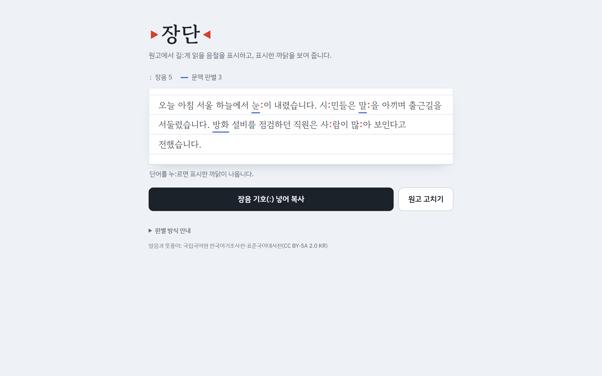
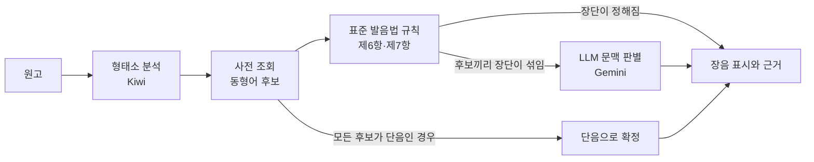

# 장단: 한국어 장단음 분석기


[](LICENSE)

원고를 넣으면 표준 발음법에 따라 길게 읽을 음절에 장음 기호(ː)를 붙이고, 그렇게 판단한 근거를 보여 줍니다.

**[공개 서버에서 바로 써 보기](https://jangdan-436361020679.asia-northeast3.run.app)** · 설치 없이 휴대폰과 PC에서 열립니다.



## 배경

표준 발음법은 모음의 장단을 구별해 발음하는 것을 원칙으로 합니다(제3장 제6항, 제7항). 그러나 현대 서울·경기 화자는 장단을 거의 구별하지 못하며, 동형어와 활용형에 따라 달라지는 장단을 판단하기 어렵습니다.

- 동형어: 눈[눈ː](하늘에서 내리는 눈) / 눈[눈](신체 기관)
- 활용형: 알다[알ː다] / 알아[아라]

그래서 원고를 규범대로 읽으려면 단어마다 사전을 찾아야 합니다. 이 도구는 아나운서, 성우 지망생, 낭독 콘텐츠 제작자처럼 원고를 규범 발음으로 읽어야 하는 사람이 사전을 찾는 수고를 덜도록 돕습니다.

## 특징

- **판단 근거 표시**: 단어를 누르면 장단을 정한 방식(사전, 규칙, LLM), 원형, 고른 동형어와 뜻풀이, 사전 링크가 나옵니다.
- **LLM은 꼭 필요한 곳에만**: 사전과 표준 발음법 규칙으로 먼저 정하고, 동형어끼리 장단이 갈리는 단어만 LLM이 문맥으로 고릅니다.
- **두 사전 결합**: 한국어기초사전을 먼저 쓰고, 없는 표기는 표준국어대사전으로 채웁니다. 잘 쓰이지 않는 동형어로 인한 불필요한 LLM 호출을 막기 위해서입니다.
- **제7항 예외 확장**: 표준국어대사전의 활용 발음을 전수조사해, 모음 어미 앞에서도 장음을 유지하는 어간의 사례를 규정에 제시된 5개에서 21개로 넓혔습니다.
- **브라우저 확장**: 웹 페이지에서 선택한 텍스트를 분석해 팝업과 페이지 안에 장음을 표시합니다.

## 처리 흐름



예: 「눈이 내리는 거리에서 사람들이 웃으며 눈을 감았다.」 → 「눈ː이 내리는 거리에서 사ː람들이 웃ː으며 눈을 감았다.」

## 측정 결과

국립국어원 말뭉치를 사용해 측정한 결과입니다. 정확도는 동형어 원형의 장단을 기준으로 잰 값입니다.

| 항목 | 결과 |
|---|---|
| 실제 글(신문·구어 말뭉치)에서 LLM 판별이 필요한 단어 | 분석한 단어의 3.7~4.7% |
| LLM 없이(사전·규칙으로) 장단이 정해지는 단어의 정확도 | 99.3% |
| 문맥 판별이 필요한 단어 11,365개의 LLM 정확도 | 94.4% (원형별로 가장 흔한 장단을 고르는 기준선은 88.2%) |
| 전체 정확도 | 99.1% |

## 구성

| 폴더 | 역할 |
|---|---|
| `prep` | 두 사전 XML 파싱, 병합, 제7항 예외 목록, 조회용 SQLite 생성 |
| `core` | 형태소 분석과 규칙 적용, 사전 조회, LLM 판별 |
| `api` | 분석 API(`POST /api/analyze`), 화면 제공, 요청 한도 |
| `web` | 웹 화면(React). 결과 표시와 API 호출은 확장과 함께 씁니다 |
| `extension` | Chrome 확장(WXT, Manifest V3) |
| `tests` | 전처리, 분석 코어, LLM 판별, API 테스트 |

## 실행

```
$ pip install -r requirements.txt    # Python 3.12
$ python -m prep.build               # 사전 DB 생성 (원시 자료 경로: JANGDAN_RAW_DIR)
$ npm --prefix web install && npm --prefix web run build    # Node.js 22.12 이상
$ uvicorn api.main:create_app --factory              # http://localhost:8000
$ pytest                             # 사전 DB가 없으면 DB를 쓰는 테스트는 건너뜀
```

> `.env`: `GEMINI_API_KEY`(없으면 LLM 판별 생략). Turso를 쓰려면 `JANGDAN_DB_SOURCE=turso`, `TURSO_DATABASE_URL`, `TURSO_AUTH_TOKEN`
>
> API: `POST /api/analyze`에 `{"text": "원고"}`. 문서는 `/docs`

### 브라우저 확장

글을 선택하고 확장 아이콘을 누르면 팝업에 장음을 표시합니다. 「페이지에 장음 표시」를 누르면 페이지 안에도 표시합니다.

```
$ cd extension
$ npm install
$ npm run build    # 로컬 서버: WXT_API_BASE=http://localhost:8000 npm run build
```

> `chrome://extensions` 개발자 모드에서 `extension/.output/chrome-mv3` 폴더 로드

## 데이터와 라이선스

- 코드: [MIT](LICENSE)
- 발음, 뜻풀이: 국립국어원 사전 전체 내려받기 자료 (한국어기초사전, 표준국어대사전; [CC BY-SA 2.0 KR](https://creativecommons.org/licenses/by-sa/2.0/kr/)). 원시 자료와 사전 DB는 저장소에 없음
- `prep/stdict_conj_pron.csv`: 표준국어대사전 웹 페이지에서 모은 활용 발음 (출처: 국립국어원 표준국어대사전, [CC BY-SA 2.0 KR](https://creativecommons.org/licenses/by-sa/2.0/kr/))
- 형태소 분석: kiwipiepy 0.23.2 (LGPL v3)
- 정확도 측정: 국립국어원 모두의 말뭉치. 이용 약정에 따라 원문은 저장소에 없음
